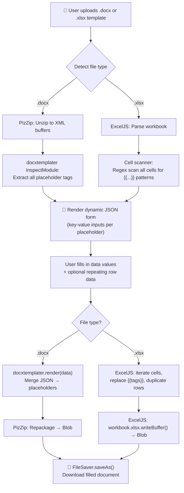

# Document & Spreadsheet Template Engine — Blueprint & Implementation Plan

Build a standalone, browser-based template engine that accepts user-uploaded `.docx` and `.xlsx` templates with placeholders, merges structured JSON data, and exports filled documents with **100% visual fidelity** — preserving headers, footers, logos, styles, merged cells, fonts, and layout.

This engine is an **isolated sandbox** — no changes to the existing SilidPinoy codebase. It will live in its own directory for independent prototyping and testing.

---

## User Review Required

> [!IMPORTANT]
> **Tech Stack Choice — 100% Client-Side (No Server):** This engine runs entirely in the browser using JavaScript + CDN libraries. No Node.js, no backend, no build step. This matches the existing SilidPinoy architecture (single HTML files with CDN scripts). Is this acceptable, or would you prefer a Node/Vite-based setup?

> [!IMPORTANT]
> **Library Licensing:**
> - **docxtemplater** (free core) handles `.docx` text/loop replacement perfectly. Image *insertion* requires a paid module, but **preserving existing images/logos** in templates is free.
> - **ExcelJS** handles `.xlsx` manipulation including styles, merged cells, and formulas in the browser.
> - Both are MIT/LGPL compatible for your use case.

---

## Open Questions

1. **Integration Scope:** The blueprint says "isolated sandbox." Should this eventually become a new tool card on the SilidPinoy homepage (like Test Creator, TOS Maker, etc.), or stay permanently separate?

2. **Image Insertion:** Do templates need *dynamic* image insertion (e.g., `{{student_photo}}` replaced with an uploaded image), or only preservation of *existing* logos/images in the template? Dynamic image insertion in `.docx` would require the paid docxtemplater Image Module or a workaround.

3. **File Naming:** The blueprint mentions `.xls` (legacy Excel). Supporting `.xls` requires a separate parser (SheetJS). Should we scope to `.xlsx` only for now?

---

## A. Tech Stack & Parsing Strategy

### Libraries (all browser-compatible, loaded via CDN)

| Purpose | Library | CDN / Source | Why |
|---|---|---|---|
| `.docx` templating | **docxtemplater** + **PizZip** | cdnjs | Battle-tested, preserves all non-text elements (headers, footers, logos, styles). Free core handles text replacement + loops + conditionals. |
| `.docx` placeholder extraction | **docxtemplater InspectModule** | Bundled with docxtemplater | Parses template AST to extract all `{{placeholder}}` tags without rendering. |
| `.xlsx` manipulation | **ExcelJS** | cdnjs | Read/write `.xlsx` with full style, merged cell, formula, and conditional formatting preservation. |
| Zip handling | **PizZip** | cdnjs | Required by docxtemplater to unzip/rezip `.docx` files. |
| File download | **FileSaver.js** | cdnjs | Cross-browser `saveAs()` for triggering downloads. |

### Placeholder Convention

Templates use **Mustache-style double-curly-brace** tags:

| Tag | Purpose | Example |
|---|---|---|
| `{{field_name}}` | Simple text replacement | `{{teacher_name}}` → "Maria Santos" |
| `{#loop_name}...{/loop_name}` | Repeating rows/sections (docx) | `{#students}{{name}} - {{grade}}{/students}` |
| `{{field_name}}` in Excel cells | Cell value replacement | Cell contains `{{school_name}}` → replaced in-place |
| `{#table_rows}` row `{/table_rows}` | Repeating Excel rows | Entire row duplicated per data entry |

> [!NOTE]
> Placeholders are embedded directly in the `.docx` text or `.xlsx` cell values by the template author using Word/Excel. The engine detects and replaces them without touching surrounding formatting.

---

## B. Processing Architecture



### Step-by-Step Workflow

1. **Upload & Validate**
   - Accept `.docx` or `.xlsx` via drag-and-drop or file picker.
   - Validate MIME type and file extension.
   - Read file as `ArrayBuffer` using `FileReader`.

2. **Extract Placeholder Keys**
   - **DOCX:** Load into `PizZip` → pass to `docxtemplater` with `InspectModule` → call `iModule.getAllTags()` to get a structured tag tree.
   - **XLSX:** Load into `ExcelJS` workbook → iterate all worksheets → all rows → all cells → regex match `/\{\{(\w+)\}\}/g` → collect unique keys.

3. **Render Dynamic Form**
   - Build a key-value form from extracted placeholders.
   - Simple fields: text input per `{{key}}`.
   - Repeating sections (`{#loop}...{/loop}` or tagged row groups): show a repeatable row-group editor with add/remove buttons.

4. **Merge Data**
   - **DOCX:** Call `doc.render(jsonData)` — docxtemplater handles all replacement, loops, conditionals while preserving every XML element it doesn't touch.
   - **XLSX:** For each cell, if value matches `{{key}}`, replace with `data[key]`. For repeating rows, clone the template row N times, copy styles cell-by-cell, shift subsequent rows down.

5. **Export & Download**
   - **DOCX:** `doc.getZip().generate({ type: 'blob' })` → `saveAs(blob, filename)`.
   - **XLSX:** `workbook.xlsx.writeBuffer()` → `new Blob([buffer])` → `saveAs(blob, filename)`.

---

## C. Dynamic Content & Edge Case Handling

### Repeating Rows

| Scenario | DOCX Strategy | XLSX Strategy |
|---|---|---|
| Table rows (e.g., student list) | `{#students}` loop tag wrapping a table row — docxtemplater natively clones the row | Clone template row, copy all cell styles via `cell.style = {...templateStyle}`, insert below |
| Numbered items | Use `{@index}` or loop index in template | Manually assign row numbers during duplication |
| Footer preservation | docxtemplater never touches footer XML | ExcelJS preserves `headerFooter` worksheet property untouched |

### Image & Logo Preservation

- **DOCX:** Images are stored as binary parts in the `.docx` zip. docxtemplater's render only modifies `document.xml` text nodes — all `word/media/*` images, `header*.xml`, and `footer*.xml` remain byte-identical.
- **XLSX:** ExcelJS preserves `xl/media/*` images and `xl/drawings/*` relationships when reading and writing. No special handling needed as long as we don't delete worksheets.

### Edge Cases

| Edge Case | Handling |
|---|---|
| Placeholder split across XML runs (`{{teach` + `er_name}}`) | docxtemplater's parser automatically merges split runs — this is a core feature |
| Empty/missing data key | Replace with empty string, show warning in UI |
| Special characters in data (e.g., `<`, `&`) | docxtemplater auto-escapes XML entities; ExcelJS handles natively |
| Very large templates (>10MB) | Show progress indicator; consider Web Worker for DOCX processing |
| Merged cells containing placeholders (XLSX) | Scan master cell only; ExcelJS correctly handles merged regions |

---

## D. Sandbox / Minimal Test UI Spec

### Architecture

A **single HTML file** (`template-engine.html`) with embedded CSS and JavaScript, matching the SilidPinoy aesthetic (Tailwind CDN, Plus Jakarta Sans font, iris color palette, glassmorphism cards).

### UI Layout

```
┌─────────────────────────────────────────────────────────┐
│  🔧 Template Engine Sandbox          [Dark Mode Toggle] │
├─────────────────────────────────────────────────────────┤
│                                                         │
│  ┌─────────────────────────────────────────────────┐    │
│  │  STEP 1: Upload Template                        │    │
│  │  ┌───────────────────────────────────────────┐  │    │
│  │  │                                           │  │    │
│  │  │   📁 Drag & drop .docx or .xlsx here      │  │    │
│  │  │      or click to browse                   │  │    │
│  │  │                                           │  │    │
│  │  └───────────────────────────────────────────┘  │    │
│  │  ✅ template_report.docx (42 KB)               │    │
│  │  Detected: 8 placeholders, 1 loop section      │    │
│  └─────────────────────────────────────────────────┘    │
│                                                         │
│  ┌─────────────────────────────────────────────────┐    │
│  │  STEP 2: Fill Data                              │    │
│  │                                                 │    │
│  │  teacher_name    [_____________________]        │    │
│  │  school_name     [_____________________]        │    │
│  │  date            [_____________________]        │    │
│  │                                                 │    │
│  │  📋 students (repeating section)                │    │
│  │  ┌─ Row 1 ──────────────────────────────┐      │    │
│  │  │ name [________] grade [___] [🗑]     │      │    │
│  │  └──────────────────────────────────────┘      │    │
│  │  ┌─ Row 2 ──────────────────────────────┐      │    │
│  │  │ name [________] grade [___] [🗑]     │      │    │
│  │  └──────────────────────────────────────┘      │    │
│  │  [+ Add Row]                                   │    │
│  │                                                 │    │
│  │  — OR paste raw JSON: ──────────────────       │    │
│  │  ┌───────────────────────────────────────┐     │    │
│  │  │ { "teacher_name": "...", ... }        │     │    │
│  │  └───────────────────────────────────────┘     │    │
│  └─────────────────────────────────────────────────┘    │
│                                                         │
│  ┌─────────────────────────────────────────────────┐    │
│  │  STEP 3: Generate                               │    │
│  │                                                 │    │
│  │  [ 🚀 Fill & Generate Document ]                │    │
│  │                                                 │    │
│  │  Status: ✅ Document generated successfully!    │    │
│  │  [ 💾 Download filled_template.docx ]           │    │
│  └─────────────────────────────────────────────────┘    │
│                                                         │
└─────────────────────────────────────────────────────────┘
```

### UI Features

1. **File Upload Zone** — Drag-and-drop with visual feedback (border glow, icon animation). Accepts `.docx`, `.xlsx` only.
2. **Auto-Generated Form** — After upload, placeholders are extracted and rendered as labeled text inputs. Loop sections render as repeatable row groups.
3. **Raw JSON Toggle** — Power users can paste/edit raw JSON directly in a code editor textarea.
4. **Fill & Generate Button** — Triggers merge engine, shows spinner during processing, then reveals download button.
5. **Download Trigger** — Uses FileSaver.js to save the resulting file with auto-generated filename.
6. **Error Handling** — Inline error messages for invalid files, missing required fields, engine errors.
7. **Dark Mode** — Toggle matching SilidPinoy aesthetic.

---

## E. Step-by-Step Implementation Roadmap

### Phase 1: Foundation & File I/O (File: `template-engine.html`)
- [x] Create HTML structure with Tailwind CDN, fonts, and design system
- [x] Build drag-and-drop file upload zone with validation
- [x] Implement `FileReader` → `ArrayBuffer` pipeline
- [x] Add file type detection (DOCX vs XLSX)

### Phase 2: DOCX Engine
- [ ] Integrate PizZip + docxtemplater via CDN
- [ ] Implement placeholder extraction using InspectModule
- [ ] Build `renderDocx(template, data)` function
- [ ] Test with sample templates (simple text, tables with loops, headers/footers)

### Phase 3: XLSX Engine
- [ ] Integrate ExcelJS via CDN
- [ ] Implement cell-level placeholder scanning
- [ ] Build `renderXlsx(template, data)` function with style preservation
- [ ] Implement row duplication for repeating sections
- [ ] Test with styled templates (merged cells, borders, logos)

### Phase 4: Dynamic Form Builder
- [ ] Parse extracted tags into form schema (simple fields vs. loop groups)
- [ ] Render auto-generated form inputs
- [ ] Implement add/remove rows for loop sections
- [ ] Add raw JSON editor toggle
- [ ] Two-way sync: form ↔ JSON

### Phase 5: Polish & Edge Cases
- [ ] Add progress indicators for large files
- [ ] Implement error boundary with user-friendly messages
- [ ] Add dark mode toggle
- [ ] Add micro-animations (upload success, generation complete)
- [ ] Test cross-browser (Chrome, Firefox, Edge)
- [ ] Add sample templates for quick demo

---

## Proposed Changes

### Template Engine Sandbox (New Standalone Component)

#### [NEW] [template-engine.html](file:///c:/Users/Sir Jopay/Desktop/Test_Generator_App/template-engine.html)
Single-file sandbox containing:
- Complete HTML structure with embedded CSS
- DOCX engine (PizZip + docxtemplater integration)
- XLSX engine (ExcelJS integration)
- Placeholder extraction logic for both formats
- Dynamic form builder that auto-generates inputs from detected tags
- File upload zone with drag-and-drop
- Fill & Generate workflow with download trigger
- Premium UI matching SilidPinoy design language (Tailwind, iris palette, glassmorphism, animations)

**CDN Dependencies loaded in `<head>`:**
- PizZip (for DOCX zip handling)
- docxtemplater (for DOCX templating)
- ExcelJS (for XLSX manipulation)
- FileSaver.js (for downloads)
- Tailwind CSS CDN (matching existing project)
- Plus Jakarta Sans + Fraunces fonts (matching existing project)

> [!NOTE]
> No existing files will be modified. This is a completely standalone sandbox file.

---

## Verification Plan

### Manual Verification
1. **DOCX Test:** Upload a `.docx` template with `{{teacher_name}}`, `{{school_name}}`, and a `{#students}...{/students}` table loop. Fill data via UI. Download and open in Word — verify text is replaced, table rows match data count, headers/footers/logos are intact.
2. **XLSX Test:** Upload an `.xlsx` template with `{{title}}` in a merged header cell and `{{student_name}}` in styled data rows. Fill and download — verify cell styles, borders, merged cells, and any images are preserved.
3. **Edge Case Test:** Upload a template with placeholders split across Word formatting runs (e.g., bold partial text). Verify engine still detects and replaces correctly.
4. **Browser Test:** Open in Chrome, Firefox, and Edge. Verify all CDN scripts load, file operations work, and downloads trigger correctly.
